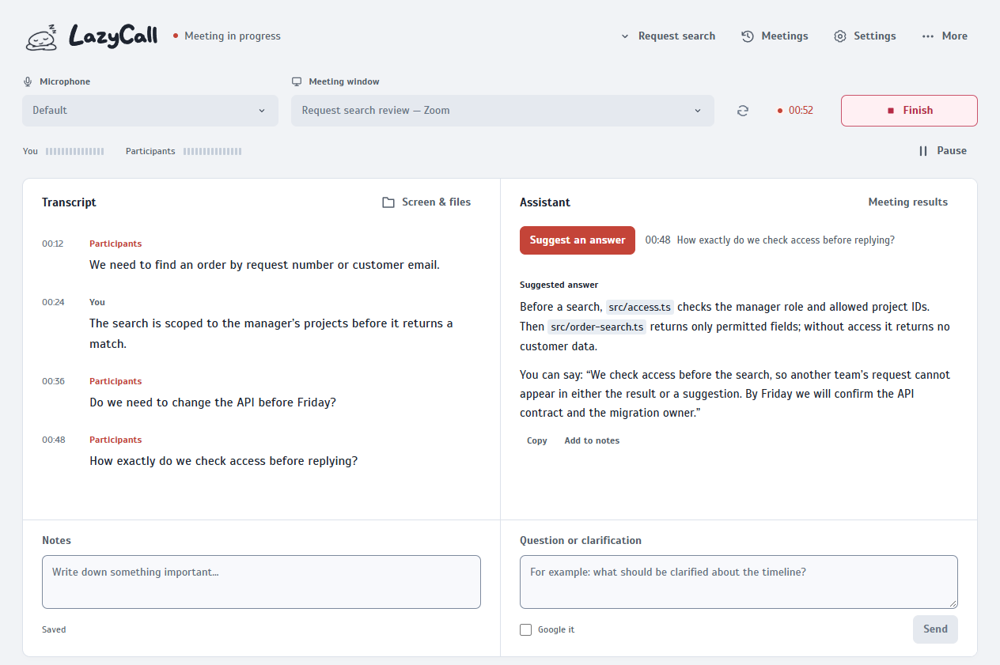
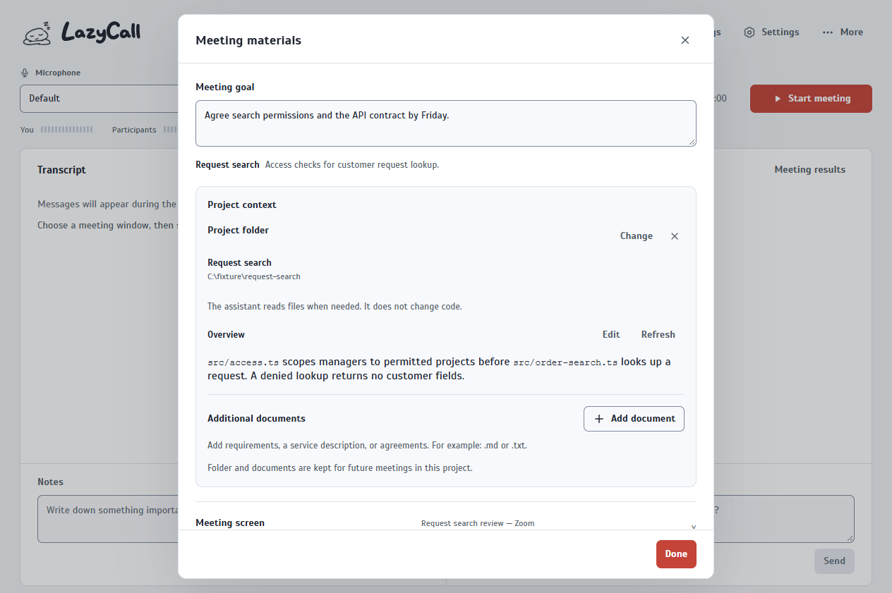
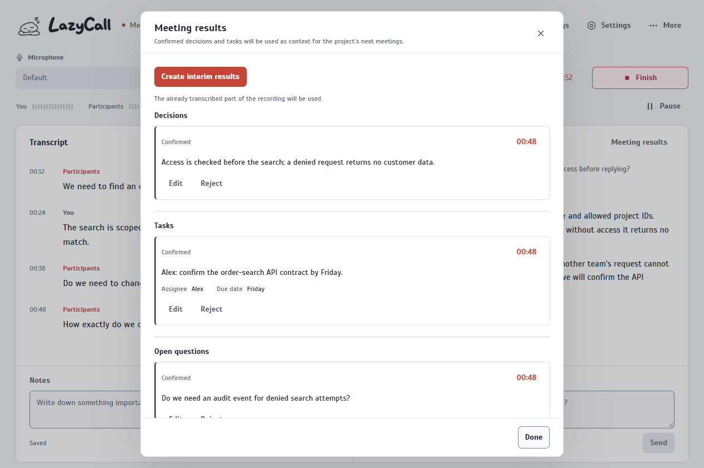
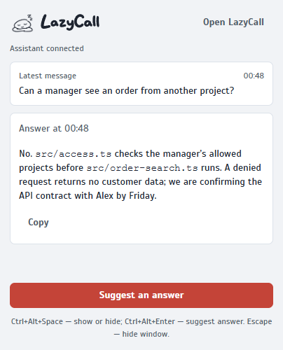
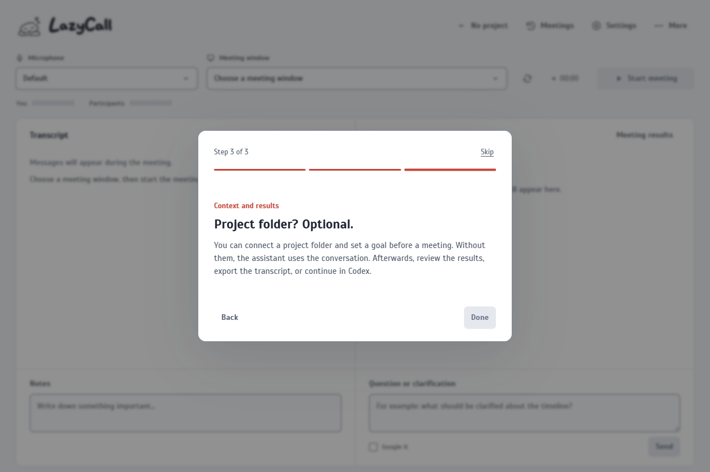

# LazyCall screenshot gallery

[Русский](SCREENSHOTS.ru.md)

A fictional order-search conversation. The language matches this page; each capture has a light and dark pair. No real meeting, repository, account, or provider material is shown.

The [layout guidelines](UI_GUIDELINES.md) describe the shared pane grid, dialog scrolling and the design references used for this interface.

## Selected synthetic English demo

These five captures describe one fictional order-search discussion. They switch between the paired light and dark captures with the reader’s theme preference.

### Main conversation

<picture><source media="(prefers-color-scheme: dark)" srcset="screenshots/readme-main-en-dark.png"></picture>

### Project context

<picture><source media="(prefers-color-scheme: dark)" srcset="screenshots/readme-context-en-dark.png"></picture>

### Meeting outcomes

<picture><source media="(prefers-color-scheme: dark)" srcset="screenshots/readme-results-en-dark.png"></picture>

### Compact window

<picture><source media="(prefers-color-scheme: dark)" srcset="screenshots/readme-compact-en-dark.png"></picture>

### Onboarding

<picture><source media="(prefers-color-scheme: dark)" srcset="screenshots/readme-onboarding-en-dark.png"></picture>

Fixture coverage and regeneration

Run `node scripts/build-screenshot-gallery.cjs` to regenerate the complete local review gallery at `release/maintainer-review/full-gallery/index.html`; `index.json` beside it is the machine-readable manifest. It uses local Playwright fixtures only.

- Main flow: idle, live, paused, saved meeting, transcript correction, follow-to-latest behavior, and responsive header/More menu.
- Assistant: empty/disconnected, project-reading stream, answer, retryable error, installed/missing Codex, and update-channel states.
- Materials, projects, meetings/history, outcomes, all settings tabs, Russian and English, light and dark themes, all onboarding steps, and compact-window states.

