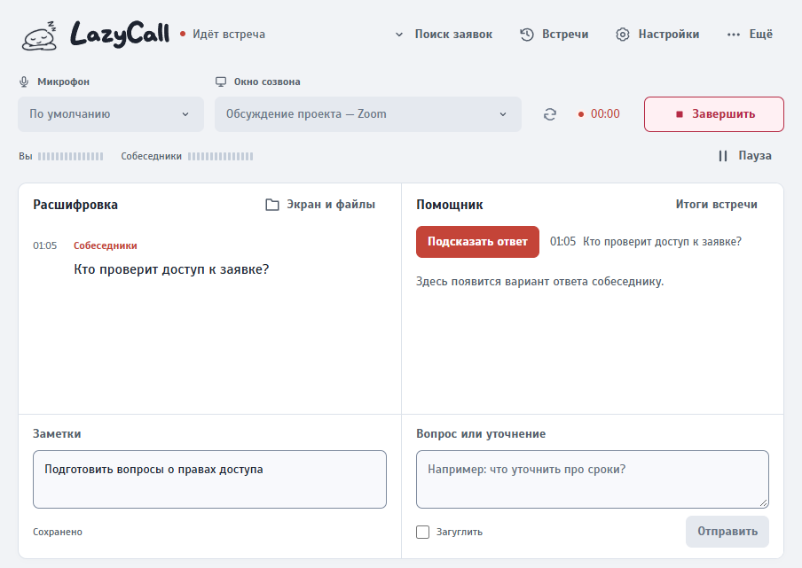
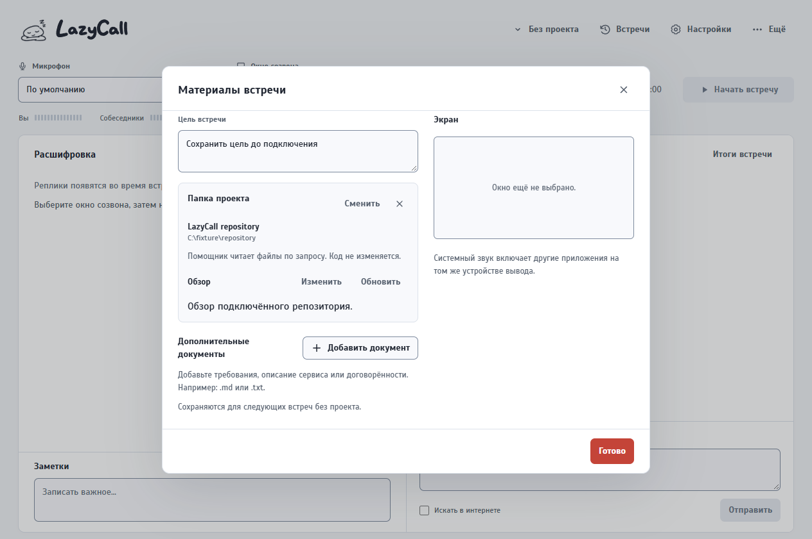
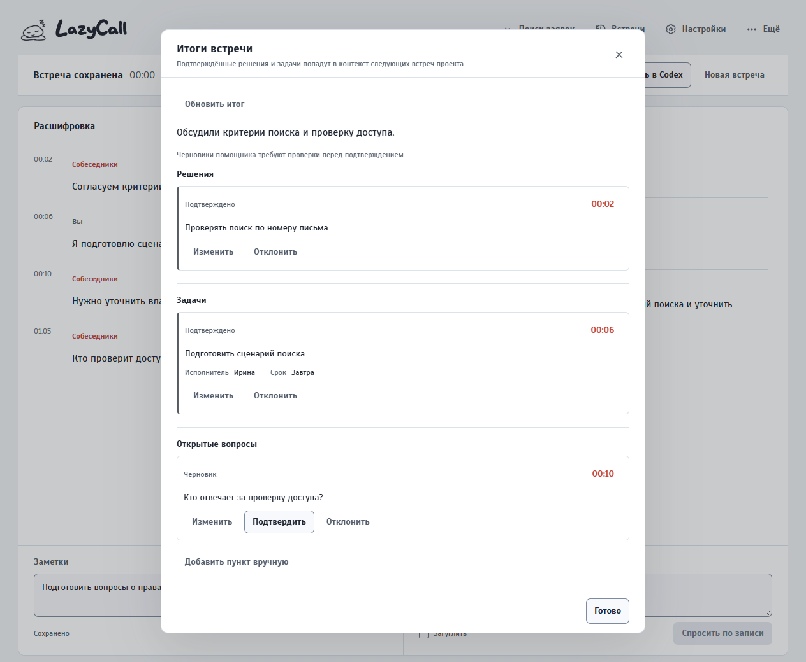
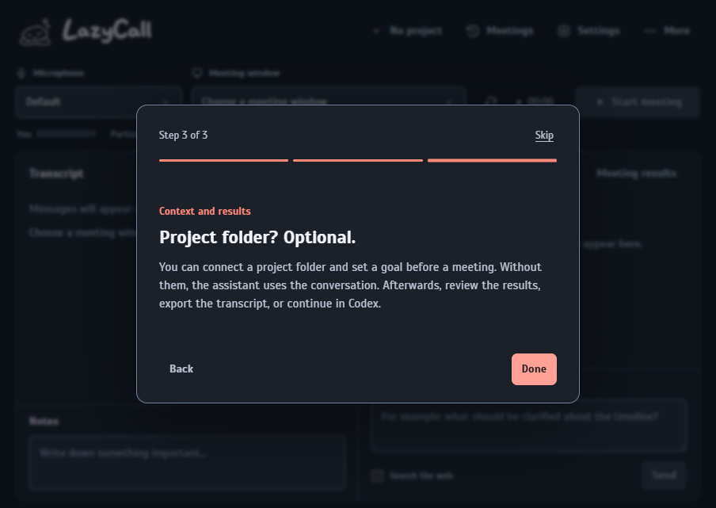
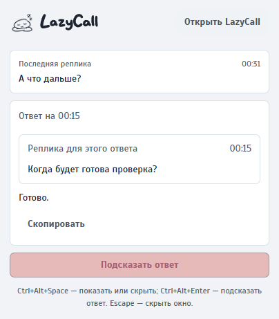
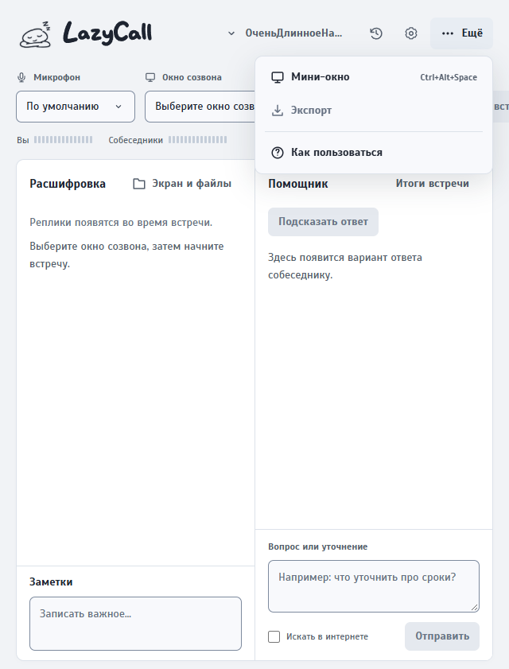

# Галерея скриншотов LazyCall

[English](SCREENSHOTS.md)

Галерея пересобирается командой `node scripts/build-screenshot-gallery.cjs`. Она использует только локальные Playwright-fixture. В ней нет реальной встречи, записи, репозитория, аккаунта, ответа провайдера, audit- или replay-скриншота.

Локальная страница для ревью создаётся в `release/maintainer-review/full-gallery/index.html`; рядом лежит машиночитаемый manifest `index.json`. В `docs/screenshots` лежит небольшая отобранная подборка, а полная локальная галерея не попадает в публичный репозиторий.

## Покрытие

- Основной сценарий: ожидание, запись, пауза (fixture-покрытие controls), сохранённая встреча, правка расшифровки, следование за последней репликой, адаптивная шапка и меню «Ещё».
- Помощник: пустое/неподключённое состояние, чтение проекта в потоке, ответ, повторяемая ошибка, найденный/отсутствующий Codex и fixture-состояния обновления.
- Материалы: нет папки, ход разбора проекта, готовый обзор и восстанавливаемая ошибка разбора.
- Проекты, история встреч и итоги: пустые/сгенерированные/устаревшие по основаниям пункты и ручная проверка.
- Настройки: запись, помощник/Codex, данные, внешний вид и обновления; русский и английский; светлая и тёмная темы.
- Онбординг: все три шага на русском и английском.
- Компактное окно: ожидание/запись, чтение проекта, ошибка и минимальная ширина.

## Выбранные кадры

| Состояние | Кадр |
| --- | --- |
| Целевая реплика во время записи |  |
| Готовый обзор подключённого репозитория |  |
| Итоги с основаниями |  |
| Английский онбординг в тёмной теме |  |
| Компактное окно |  |
| Адаптивная шапка |  |
